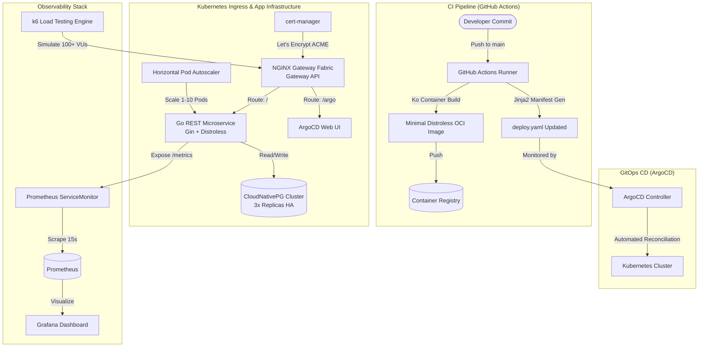

# Cloud-Native DevOps & GitOps Platform

[](https://go.dev/)
[](https://kubernetes.io/)
[](https://argoproj.github.io/cd/)
[](https://prometheus.io/)
[](https://opensource.org/licenses/MIT)

An end-to-end, production-grade Cloud-Native DevOps platform demonstrating declarative **GitOps continuous delivery**, **Kubernetes Gateway API** ingress routing, **automated TLS certificates**, **high-availability database clustering**, and **full-stack observability**.

---

## 🏛️ Architecture Overview



---

## 🚀 Key Highlights & Engineering Features

### 1. High-Performance Microservice Backend
- Developed in **Go 1.22** using the high-performance **Gin** framework.
- Built-in connection pooling and robust error handling for PostgreSQL persistence.
- Instrumented with native **Prometheus Client Library**, exporting custom metrics (`http_requests_total`, `add_goal_requests_total`, `remove_goal_requests_total`).
- Dedicated health check probes (`/health`) and metrics endpoints (`/metrics`).

### 2. Modern Containerization & Supply Chain Security
- Built using **`ko`** and **distroless base images**, yielding lightweight, ultra-secure container images without package managers or shell vulnerabilities.
- Nix-based reproducible development environments configured with **BSF (Build System Framework)**.

### 3. Declarative GitOps Pipeline (ArgoCD + GitHub Actions)
- Automated CI pipeline: triggers on commits to `main`, compiles and containerizes Go binaries with `ko`, and updates deployment manifests using Jinja2 templating.
- ArgoCD continuously reconciles cluster state against repository specifications, providing zero-touch, drift-resistant continuous deployments.

### 4. Next-Gen Kubernetes Gateway API & Ingress
- Implements standard **Kubernetes Gateway API** via **NGINX Gateway Fabric**, moving away from legacy Ingress controllers.
- Integrated with **cert-manager** to automatically issue and renew production SSL/TLS certificates via Let's Encrypt HTTP-01 solvers.
- Cross-namespace routing to ArgoCD services secured via Kubernetes `ReferenceGrant`.

### 5. High-Availability Clustered Persistence
- Deploys **CloudNativePG** (Postgres operator) orchestrating a 3-instance PostgreSQL cluster with automated failover and persistent volume management.
- Dynamic credential injection via Kubernetes Secrets for decoupled database access.

### 6. Full-Stack Observability & Load Testing
- Monitored using **Prometheus Operator** (`kube-prometheus-stack`) with custom `ServiceMonitor` definitions.
- Visual metrics dashboards in **Grafana** tracking request throughput, error rates, and cluster resource saturation.
- Stress and load-testing verification via **k6** scripts with 100+ virtual users simulating production load.

---

## 📂 Repository Structure

```
├── main.go                     # Go microservice with Gin & Prometheus instrumentation
├── go.mod / go.sum             # Go module definition & dependency lock
├── kodata/                     # Static UI assets and templates
├── deploy/                     # Kubernetes production deployment manifests
│   └── deploy.yaml             # Complete deployment, Gateway API, and service definitions
├── tmpl/                       # Dynamic deployment templates (Jinja2)
├── argo-gateway.yaml           # Gateway API definition for application & ArgoCD
├── cluster_issuer.yaml         # cert-manager Let's Encrypt ClusterIssuer
├── hpa.yaml                    # Horizontal Pod Autoscaler configuration (1-10 replicas)
├── pg_cluster.yaml             # CloudNativePG 3-instance HA database cluster
├── referencegrant              # Gateway API ReferenceGrant for cross-namespace routing
├── route-argo.yaml             # HTTPRoute definition for ArgoCD dashboard
├── servicemonitor.yaml          # Prometheus ServiceMonitor configuration
├── prometheus.yml              # Local Prometheus scraping configuration
├── load.js                     # k6 automated load testing scenario
├── bsf.hcl / bsf.lock          # BSF package specification and lockfile
├── .github/workflows/          # CI/CD workflows
│   └── build_push.yml          # Automated ko build, push, and manifest update pipeline
└── LICENSE                     # MIT License
```

---

## 🛠️ Local Development & Quick Start

### 1. Prerequisites
- [Docker](https://docs.docker.com/get-docker/) & [Docker Compose](https://docs.docker.com/compose/)
- [Go 1.22+](https://golang.org/dl/)
- [kubectl](https://kubernetes.io/docs/tasks/tools/) & [Helm](https://helm.sh/)
- [ko](https://ko.build/) (optional, for direct container builds)

### 2. Run Locally with Docker
Spin up PostgreSQL, Prometheus, and Grafana:
```bash
# 1. Start PostgreSQL
docker run -d --name local-postgres \
  -e POSTGRES_USER=myuser \
  -e POSTGRES_PASSWORD=mypassword \
  -e POSTGRES_DB=mydb \
  -p 5432:5432 postgres:15-alpine

# 2. Initialize database table
docker exec -i local-postgres psql -U myuser -d mydb << 'EOF'
CREATE TABLE goals (
    id SERIAL PRIMARY KEY,
    goal_name TEXT NOT NULL
);
EOF

# 3. Run Prometheus & Grafana
docker run -d --name prometheus -p 9090:9090 -v $(pwd)/prometheus.yml:/etc/prometheus/prometheus.yml prom/prometheus
docker run -d --name grafana -p 3000:3000 grafana/grafana
```

Run the application:
```bash
export DB_USERNAME=myuser
export DB_PASSWORD=mypassword
export DB_HOST=localhost
export DB_PORT=5432
export DB_NAME=mydb

go run main.go
```
The application will be accessible at `http://localhost:8080`, with metrics available at `http://localhost:8080/metrics`.

---

## ☸️ Kubernetes Deployment Guide

### 1. Cert-Manager & Gateway API
```bash
# Install cert-manager
kubectl apply -f https://github.com/cert-manager/cert-manager/releases/download/v1.15.3/cert-manager.yaml

# Install Gateway API CRDs & NGINX Gateway Fabric
kubectl kustomize "https://github.com/nginxinc/nginx-gateway-fabric/config/crd/gateway-api/standard?ref=v1.3.0" | kubectl apply -f -
helm install ngf oci://ghcr.io/nginxinc/charts/nginx-gateway-fabric --create-namespace -n nginx-gateway
```

### 2. High-Availability PostgreSQL Cluster
```bash
# Install CloudNativePG Operator
kubectl apply --server-side -f https://raw.githubusercontent.com/cloudnative-pg/cloudnative-pg/release-1.23/releases/cnpg-1.23.1.yaml

# Deploy database cluster & credentials
kubectl apply -f pg_cluster.yaml
```

### 3. Deploy Application & Ingress Routing
```bash
kubectl apply -f deploy/deploy.yaml
kubectl apply -f hpa.yaml
kubectl apply -f servicemonitor.yaml
```

### 4. Load Testing with k6
Validate autoscaling behavior under load:
```bash
k6 run --env TARGET_URL=http://localhost:8080 load.js
```

---

## 👤 Author

**Vedant Borse**
- GitHub: [@vedantborse-ai](https://github.com/vedantborse-ai)
- LinkedIn: [vedant-borse](https://www.linkedin.com/in/vedant-borse-3957b4332/)
- Email: [vedantpborse@gmail.com](mailto:vedantpborse@gmail.com)

---

## 📄 License
This project is open-source and licensed under the [MIT License](LICENSE).
